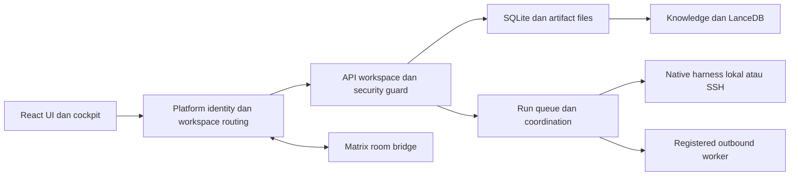

# Arsitektur personal-agentic

Peta ini membedakan kondisi source, target produk dan bukti environment. [PRD](PRD.md) menyimpan kebutuhan; [development](docs/development.md) mengatur perubahan; [verification](src/VERIFICATION.md) dan [runbook release](docs/DEV-PROD-WORKFLOW.md) menentukan cara membuktikan hasil. Snapshot di bawah diperiksa 11 Oktober 2026 terhadap baseline main `7008877`; status environment harus diperiksa lagi sebelum operasi.

## Jalur utama

| Batas | Source utama dan tanggung jawab |
| --- | --- |
| Entrypoint controller/worker | [main.rs](src/backend/src/main.rs): argumen, organization lock, bootstrap, HTTP server, dan mode worker |
| Identitas dan workspace | [platform.rs](src/backend/src/platform.rs): login/membership, platform identity database, pemilihan organization/workspace sebelum API workspace |
| API dan autentikasi | [api.rs](src/backend/src/api.rs), [security.rs](src/backend/src/security.rs): endpoint aplikasi, origin/auth guard, response/error, serving frontend dan SSE |
| State organisasi | [store.rs](src/backend/src/store.rs), [model.rs](src/backend/src/model.rs), [migrations](src/migrations): SQLite `app.sqlite3`, transaksi, events dan metadata |
| Run dan kerja kolaboratif | [runtime.rs](src/backend/src/runtime.rs), [coordination.rs](src/backend/src/coordination.rs): antrean, session, outcome, dispatch dan hasil delegasi; [schedules.rs](src/backend/src/schedules.rs) serta [actions.rs](src/backend/src/actions.rs) memakai alur aplikasi |
| Harness dan SSH | [antigravity.rs](src/backend/src/antigravity.rs), [opencode.rs](src/backend/src/opencode.rs), [remote.rs](src/backend/src/remote.rs), [remote bridge](src/backend/src/remote_bridge.py), [workstations.rs](src/backend/src/workstations.rs): native CLI, workstation, transport dan stop/heartbeat |
| Registered runtime | [fleet.rs](src/backend/src/fleet.rs): worker terdaftar, koneksi outbound, enrollment dan execution; kemampuan transport tidak selalu sama dengan SSH |
| File dan knowledge | [run_files.rs](src/backend/src/run_files.rs), API artifact, [knowledge.rs](src/backend/src/knowledge.rs): containment preview, artifact bytes/metadata, indexing dan retrieval LanceDB/FastEmbed |
| UI dan visualisasi | [frontend](src/frontend/src), [cockpit adapter](src/frontend/src/LivePreview.tsx), [scene lifecycle](src/cockpit/src/client/lifecycle.js): state aplikasi dan scene read-only pada origin yang sama |
| Matrix | [matrix.rs](src/backend/src/matrix.rs), [deployment contract](src/DEPLOYMENT.md): identitas/room bridge dengan state workspace yang terpisah |
| Release | [GitLab CI](.gitlab-ci.yml), [production Compose](infra/production/compose.yaml), [release helper](infra/production/release.py): verifikasi, image ARM64, digest smoke, backup dan promotion |

`platform.sqlite3` menyimpan identitas platform dan membership; setiap workspace mempunyai organization store sendiri. SQLite adalah sumber state aplikasi; LanceDB adalah indeks retrieval. File artifact dan native/session state tidak boleh dianggap dapat dipulihkan hanya dari image aplikasi.

Controller/UI dan host eksekusi adalah batas berbeda. `localhost:18766` menunjukkan akses controller development; agen yang memilih workstation SSH menjalankan native CLI pada host tersebut. Session, credential dan effective workdir mengikuti adapter serta workspace/profile yang dipilih. Folder berbeda tidak menjamin isolasi OS ketika native execution memakai akses penuh.

## Kondisi, target dan batas bukti

| Topik | Kondisi yang diketahui | Cara menilai perubahan |
| --- | --- | --- |
| Source baseline | Main `7008877` memuat controller Rust/Axum, React UI, cockpit, SQLite/LanceDB, native/SSH harness dan registered worker paths | Adanya kode bukan bukti seluruh scenario/platform sudah lolos; gunakan verification per capability |
| Artefak run Antigravity | Enhancement dilacak pada [Issue 1](https://gitlab.tugasakhir.space/rizkyyanuark/personal-agentic/-/work_items/1) dan branch `codex/antigravity-run-artifacts`; belum menjadi capability baseline main pada snapshot ini | Gunakan MR fitur dan hasil CI pada revisi terbaru; bukti working tree terdahulu tidak otomatis menerima revisi setelah review atau menjadi release server |
| Target produk | PRD mempunyai amendment yang menggantikan beberapa kebutuhan lama | Baca kebutuhan yang berlaku dan kontrak change; capability deferred tidak diumumkan sebagai verified |
| Runtime matrix | Local, SSH dan registered worker memiliki entrypoint berbeda | Verifikasi adapter dan OS yang terdampak, termasuk auth, stop, resume dan file boundary; jangan mewariskan proof satu transport ke transport lain |

## Snapshot release 11 Oktober 2026

Audit GitLab project 5 `rizkyyanuark/personal-agentic` mendapati protected main `7008877`, pipeline [#25](https://gitlab.tugasakhir.space/rizkyyanuark/personal-agentic/-/pipelines/25) sukses, termasuk image publish/smoke dan deploy job 104; deployment production 9 menunjuk SHA yang sama. Runner 3 dan 4 online saat pemeriksaan. Direct push main tidak diizinkan, merge oleh Maintainers dan pipeline sukses diwajibkan. Resolusi semua diskusi belum menjadi syarat merge project. Pemeriksaan publik [health](https://agent.tugasakhir.space/api/health) memberikan HTTP 200 dengan status ok.

Ini snapshot metadata pipeline/deployment dan endpoint health, bukan pemeriksaan ulang provider atau seluruh alur produksi. Catatan bootstrap/maintenance bertanggal pada runbook merupakan sejarah. Keadaan domain, proses dan release aktif harus dibuktikan lagi pada pekerjaan operasional yang membutuhkannya.

GitLab self-hosted menjadi canonical; GitHub adalah downstream mirror. Dev dan prod memakai controller state, owner credential dan volume yang berbeda. Runbook mencatat identitas AGY/provider Ubuntu yang dibagi pada tahap persiapan; snapshot ini tidak membuktikan pemisahan akun runtime atau OS. Production mempromosikan digest image dari reviewed main; tidak membangun source pada saat deploy.

## Perubahan arsitektur

Perubahan API, auth, session, schema, artifact/path, runtime atau release memerlukan kontrak eksplisit sesuai [template](openspec/templates/change.md). Tambahkan ADR ketika keputusan memengaruhi beberapa capability. Pertahankan boundary yang ada sebelum membuat modul/persistence paralel.

[UPSTREAM](src/UPSTREAM.md) mencatat CCCC/Paperclip dan provenance komponen. Gunakan source reference untuk keputusan teknis; jangan menganggap kedua proyek mempunyai environment, adapter atau kebijakan development yang sama dengan personal-agentic.
