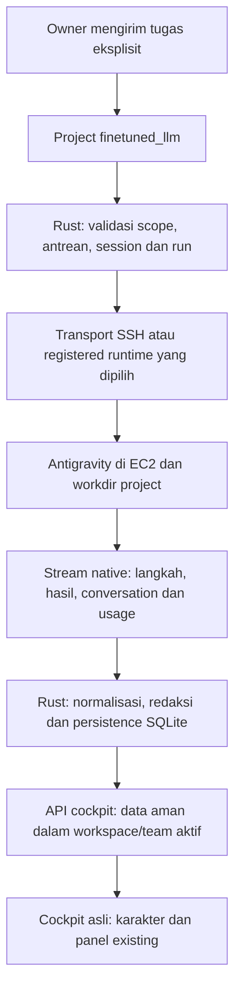

# Pilot Antigravity SSH dan observasi cockpit

Tanggal audit awal: 6 Oktober 2026; verifikasi ulang: 7 Oktober 2026, Asia/Jakarta.
Status: integrasi direct SSH sudah dihubungkan dan image final sudah dipasang pada
aplikasi utama. Lima agent dan project `finetuned_llm` sudah tersimpan memakai
`claude-sonnet-4-6`, pilihan alternatif dari katalog setelah quota Gemini Flash
High. Audit Direct Nova pada aplikasi utama berhasil dengan provider nyata:
tiga dokumen dibaca, hasil kembali ke chat, dan aktivitas muncul di cockpit.
Koordinasi Orion juga lulus pada sesi baru: satu keputusan coordinator, satu audit
Lyra, dan satu ringkasan Orion kembali ke chat utama project. Ketiga proses native
berakhir exit 0; screenshot menangkap aktivitas bekerja, membaca file dan selesai.
Percobaan terdahulu yang gagal tetap disimpan sebagai riwayat, termasuk quota dan
error subscriber stream native Antigravity.

## Keputusan pemilik yang sudah diterima

- Server yang sama: SSH `ec2`, user `ubuntu`, key `mini-project-key.pem`.
- Satu project `finetuned_llm`; Orion koordinator dan empat spesialis sebagai tim.
- Tugas pertama: audit repo melalui chat, tanpa perubahan source atau training.
- Periksa akun Antigravity yang sudah ada di server.
- Desain asli cockpit, overlay, header dan kontrol kamera tetap dipertahankan.
- Lengkapi direct SSH dahulu; registered worker menjadi tahap berikutnya.
- Docker mendapat satu key yang dipilih sebagai read-only bind mount. Fingerprint
  dibandingkan dengan sesi SSH Windows yang sudah dipercaya sebelum disimpan.
- Pilot awal memakai model default katalog server. Setelah kegagalan quota Flash
  High, pemilik meminta model alternatif dari katalog. Pilot memilih Claude
  Sonnet 4.6 Thinking melalui perubahan konfigurasi yang disetujui; tidak ada
  fallback otomatis. Simpan project dan konfigurasi lima agent setelah pengujian.
- Satu proses provider aktif pada pilot. `@Orion` mengoordinasikan project,
  sedangkan mention spesialis menjalankan tugas langsung. Pesan biasa tidak
  memulai pekerjaan.
- Pantau hanya tugas yang dimulai personal-agentic. Subagent native merupakan
  detail induk, bukan karakter Organization baru.
- Polling cockpit tetap 2 detik. Kategori langkah dan filename relatif boleh
  tampil; raw command, isi file, credential dan path pribadi tidak boleh tampil.
- Kegagalan mendapat review manager, tanpa retry otomatis. Owner memulai retry
  secara eksplisit setelah melihat penyebabnya.

## Temuan audit dan konteks awal

Baris aplikasi, transport, telemetry dan routing berikut mencatat keadaan sebelum
implementasi. Snapshot server memiliki waktu pemeriksaannya sendiri; status
implementasi dan hasil execution yang terbaru dicatat terpisah di bawah.

| Area | Bukti | Implikasi |
| --- | --- | --- |
| Path SSH | `/home/ubuntu/workspace/projects/finetuned_llm` ada | Gunakan path absolut ini setelah probe aplikasi berhasil. |
| Isi folder | `AGENTS.md`, `PROJECT_BRIEF.md`, `EXPERIMENT_PLAN.md`; bukan Git repo | Pilot mengaudit dokumen; branch/worktree baru memerlukan keputusan terpisah. |
| Batas proyek | AGENTS dan brief menetapkan riset/planning; experiment plan memuat persetujuan lebih luas | Jangan menganggap dokumen sebagai izin training; permintaan terbaru pemilik adalah audit baca-saja. |
| CLI server | Audit awal `1.2.16`; verifikasi 7 Oktober `1.3.0`; `agy models` berhasil | Versi dapat berubah. Catalog terjangkau, tetapi login/job perlu run nyata. |
| Model | Katalog menampilkan Gemini Flash/Pro, Claude Sonnet/Opus, GPT-OSS | Model diambil dari host eksekusi; tidak diam-diam fallback. |
| Kapasitas | 2 vCPU; RAM 1835 MiB, available 309 MiB saat inspeksi | Rekomendasi pilot satu pekerjaan aktif. Ini snapshot, bukan SLA. |
| Aplikasi pada audit awal | 7 agent, 5 slot cockpit, 0 active run; belum ada workstation/project SSH | Konfigurasi connection + project kemudian dilakukan melalui API asli. |
| Status existing | `/api/cockpit/state` dan polling 2 detik sudah terhubung | Pertahankan auth, workspace scope dan projection existing. |
| Jalur SSH pada audit awal | Bridge hanya menerima Codex/OpenCode; handler `antigravity_settings` belum ada | Integrasi memerlukan perubahan transport selain dropdown. |
| MCP | Argument MCP Codex dibuang ketika command diganti ke Antigravity | `ask_user`, action/cross-chat belum boleh dianggap tersedia di AGY. |
| Telemetry pada audit awal | Stream AGY disimpan sebagai evidence; cockpit memproyeksikan lifecycle saja | Typed activity projection kemudian dihubungkan ke panel existing. |
| Routing pada audit awal | Pesan eksplisit mengantrekan `Direct`; coordinator JSON belum dipanggil melalui chat project | Routing eksplisit lead project kemudian dihubungkan ke coordinator existing. |

## Status implementasi dan verifikasi 7 Oktober 2026

- Direct SSH menerima harness Antigravity dan memetakan executable ke `agy`.
  Model catalog dan probe memakai CLI pada host eksekusi. Kesiapan project memakai
  harness anggota yang aktif, dengan prioritas lead untuk tampilan connection;
  tim AGY tidak memerlukan login Codex. Probe memeriksa CLI `--version` dan batas
  workspace saja. Catalog diperiksa terpisah sebelum execution; status siap tidak
  menjanjikan autentikasi, quota atau keberhasilan model pada run berikutnya.
- Mention lead project memulai `Coordinator`; mention spesialis memulai `Direct`.
  Keputusan schema, validasi delegasi, antrean dan summary memakai jalur existing.
  Alur coordinator → delegate → summary lulus dengan provider nyata pada aplikasi
  utama. Summary melanjutkan conversation native coordinator; tidak memulai audit
  kedua maupun delegasi tambahan.
- Discovery AGY memiliki process group yang dimiliki bridge dan dihentikan pada
  sukses maupun timeout. Pipe stdout/stderr ditutup meskipun cleanup gagal.
  `--version` dibatasi 4 detik dan `agy models` 20 detik; batas RPC Rust tetap
  35 detik. Monitor tidak menjalankan `agy models` maupun `--help`, sehingga tidak
  memulai discovery catalog setiap 30 detik. Batas default command harness lain
  tetap 12 detik. Execution AGY memakai `--print-timeout 0` agar watchdog profile
  mengendalikan batas waktu run.
- Image utama `agentic-enterprise-cockpit:ssh-probe-final` sudah dipasang dengan satu key
  terpilih sebagai read-only mount `/run/ae-ssh/mini-project-key.pem`. Rollback
  disimpan sebagai `agentic-enterprise-platform:pre-ssh-pilot-20261007`.
  Deployment image tidak dengan sendirinya membuktikan pilot provider utama lulus.
- Konfigurasi project dan lima profile utama ke Claude Sonnet 4.6 Thinking sudah
  tersimpan dan probe lima agent berhasil. Model berasal dari catalog native; tidak ada retry atau
  pergantian model otomatis setelah quota error.
- Coordinator AGY diminta menghasilkan keputusan routing dari konteks Organization
  yang sudah disediakan. Rust memvalidasi dan mengantrekan delegasi setelah provider
  coordinator selesai. Summary memakai hasil worker yang tersimpan, tanpa mengulang
  audit. Schema native, queue dan persistence tetap memakai arsitektur aplikasi.
- State native `ERROR` mengakhiri aktivitas typed sebagai failed. Antigravity tidak
  membutuhkan token tool enterprise; token/MCP Codex dan OpenCode tetap mengikuti
  validasi existing. MCP enterprise belum dihubungkan ke harness AGY.

| Pemeriksaan | Hasil yang sudah tercatat | Batas bukti |
| --- | --- | --- |
| Rust | Format lulus; 111 tes lulus, 0 gagal, 0 ignored | Verifikasi source/backend final, bukan bukti semua model provider tersedia. |
| Frontend/cockpit | Lint, format, build dan 200 tes lulus | Tidak menggantikan pilot aplikasi utama. |
| Bridge discovery | 10 contract tests lulus; 2 fixture proses Linux nyata lulus dengan `-W error::ResourceWarning` | Provider receipt pada contract memakai fixture boundary eksternal; tes Linux memakai proses dan signal nyata tanpa provider. |
| Cleanup Linux | Sukses 0,552 detik; timeout 1,703 detik; kedua kasus FD 4 → 4 dan 0 anggota group yang masih hidup | Parent direap; satu child zombie sementara tetap di bawah PID 1 container. Tes timeout memeriksa FD saat traceback exception masih hidup. |
| Nova Direct pada kandidat | Run `cf258753-dc6a-4f69-b0e7-fbc367ed47cb` berstatus `succeeded`, exit 0; native session dan dua SSH receipt terkonfirmasi | Tiga dokumen menghasilkan event `reading` completed; screenshot menangkap working dan reading. Ini bukti Direct kandidat, bukan koordinasi atau pilot utama. |
| Orion pada kandidat | Run `8ffdc76c-b27b-4ca1-b6ed-ed4f5b8c3fd1` berstatus `failed`; model Flash High melaporkan quota provider | Tahap delegate dan summary belum lolos. Kegagalan quota tidak disamakan dengan kegagalan transport SSH atau login. |
| Membuka preview kandidat | 0 run baru; maksimum 1 provider turn aktif yang diamati | Script keseluruhan masih `passed: false`; pemeriksaan konfigurasi akhir belum dicapai, sehingga belum membuktikan seluruh acceptance. |
| Nova Direct pada aplikasi utama | Run `007644cc-db1d-4452-b126-97d7e74a336d` succeeded, exit 0, model Sonnet; 3 native file readers completed, 0 tool error, 2 SSH receipts | Tidak memakai command/write. Usage terukur dari 2 model step: 36.113 input + 1.570 output = 37.683 token. Screenshot working/reading tersedia. |
| Orion pertama pada aplikasi utama | Run `04c96f1a-8162-4015-9ac1-a95c5588b0c2` cancelled setelah native mencoba membaca directory dan mengantrekan `ls` | Batas pilot menghentikan run; partial response tidak dianggap sukses. Instruksi coordinator routing-only kemudian diperjelas. |
| Discovery coordinator | Run `68be6503-ef86-41f6-9d9c-55f4fd71a38a` gagal sebelum proses provider dimulai karena timeout `agy models` | Monitor catalog berulang dihapus dari probe. Native session yang sudah tersimpan tidak membuktikan execution baru dimulai. |
| Stream coordinator pada image final | Run `4c66a33a-d688-4d2f-9bce-24f22b78de1a` failed, exit 1; native result ERROR: subscriber fell behind updates, stalled for 6s | 248 ACTIVE response frames diterima selama 15,19 detik; jeda maksimum 0,90 detik. Tidak ada structured output final. Belum membuktikan adapter Rust menyebabkan error subscriber. |
| Koordinasi dari sesi baru | Coordinator `a9024442-9d96-400e-bae2-2f5de64211f6` delegated, Lyra `b1f26056-df1c-42ae-9a13-48f05bf8a3b1` succeeded, summary `ea4d880d-6d41-4c66-a71d-6776c3ac032a` succeeded; semuanya exit 0 | Pilot aplikasi `passed: true`: tepat 3 provider turns, maksimum 1 provider aktif, 15 event aktivitas nyata, summary tersimpan di chat dan memakai conversation coordinator. Profiles/project tetap identik. |
| Accounting native sesudah koordinasi | API verification lulus: coordinator 29.102, Lyra 38.368, summary 24.525 token; jumlah 91.995 | Seluruh nilai cocok dengan input/output step native yang dideduplicate. Coordinator dan summary memiliki indeks step terukur yang tidak tumpang tindih; cumulative conversation result tidak dijumlah ulang. |
| Sesi baru dan riwayat | Verifikasi WAL-aware lulus: 9 pesan dan 6 run historis tetap identik, profiles/groups tetap identik | 3 sesi project lama dipertahankan dengan native ID utuh dan dinonaktifkan; 1 sesi group lain tidak berubah. Reset membuat 0 run; pemeriksaan akhir menemukan 0 active run. |
| Integritas project server | 3 file; hash seluruh file sama sebelum/sesudah pilot utama | Tidak ada source baru, training, download atau perubahan dokumen dari pilot. |
| Desain aplikasi utama sesudah pilot final | 9 viewport, 18 komponen overlay asli per viewport, desktop/touch card→kamera, refresh dan modal lifecycle lulus | Header desktop 49 px, ponsel 53 px, landscape touch 57 px; preview membuat 0 run. Resize mempertahankan canvas; perubahan pixel kamera 39,74%. Stylesheet embed memiliki namespace, bukan salinan byte-identik. |

Bukti lokal yang sudah ada berada di `scratch/cockpit-verification/`:

- `ssh-candidate-pilot/cockpit-ssh-pilot-proof.json` dan screenshot di folder yang
  sama: keberhasilan Direct, activity nyata dan tahap koordinasi yang gagal.
- `ssh-probe-final-backend-verification.log`: 111 tes Rust.
- `ssh-frontend-check.log`: 200 tes frontend/cockpit, lint, format dan build.
- `antigravity-bridge-contract.py` dan `antigravity-discovery-process-proof.py`:
  contract boundary dan fixture proses Linux untuk helper final.
- `ssh-final-rollout-proof.json`: image final, lokasi backup, mount key read-only,
  HTTP 200 dan preservation konfigurasi/history saat deploy.
- `ssh-main/configuration-proof.json`: lima agent siap, project dan model tersimpan.
- `ssh-main-pilot/cockpit-ssh-pilot-proof.json`: keberhasilan Nova Direct pada
  aplikasi utama; script keseluruhan gagal pada tahap coordinator berikutnya.
- `ssh-final-coordination/cockpit-ssh-pilot-proof.json`: kegagalan stream native,
  cancel review milik pilot, tidak ada run pilot yang masih aktif.
- `ssh-native-stream-measurement.json`: jumlah frame, bytes dan jeda persistence,
  tanpa isi respons, argument atau credential.
- `ssh-final-coordination-before.sha256` dan `ssh-final-coordination-after.sha256`:
  ketiga dokumen tidak berubah.
- `ssh-fresh-coordination/cockpit-ssh-pilot-proof.json`: coordinator → Lyra →
  summary lulus; tiga screenshot kerja/baca dan screenshot completed.
- `ssh-fresh-coordination/ssh-native-accounting-proof.json`: tiga SUCCESS native,
  scope reader tiga dokumen, schema coordinator dan delegasi tersimpan, usage
  per-step lengkap, serta resume tanpa indeks step terukur yang tumpang tindih.
- `ssh-native-finish-contract-proof.json`: empat kontrak positif dan 23 rejection
  untuk receipt output JSON. Fixture ini melengkapi pemeriksaan provider nyata.
- `ssh-fresh-session-retention-corrected-proof.json`: retention ketat melalui
  SQLite/WAL/SHM dan API asli. Pemeriksaan awal yang salah karena wrapper array
  PowerShell dan base database lama tetap disimpan sebagai diagnostic terpisah.
- `ssh-fresh-coordination/project-after.sha256`: hash seluruh project setelah
  koordinasi sukses tetap sama dengan sebelum pengujian.
- `ssh-release-parity.log` dan `ssh-release-parity/`: parity overlay pada sembilan
  viewport dari aplikasi utama sesudah pilot final, termasuk screenshot desktop
  dan ponsel.

Script acceptance mencocokkan native session, positive remote PID, executable
`agy`, canonical workdir, native SUCCESS, dua SSH receipt per run, tugas Lyra,
summary yang tersimpan dan tidak adanya run tambahan. Tool `finish` native
merupakan keluaran JSON coordinator. Snapshot ACTIVE memotong preview task menjadi
512 karakter ditambah ellipsis; ia belum merupakan argument final. Pemeriksaan
terpisah menerima hanya preview yang persis sama atau terpotong dengan ellipsis
dan prefix yang cocok, lalu memvalidasi schema hasil native final serta kesamaan
reply, agent ID, task lengkap dan scope delegasi yang disimpan Rust. Snapshot
ACTIVE tidak dinyatakan DONE. Tool file tetap dibatasi ke `view_file`/`read_file`
pada tiga dokumen pilot.
Sesi baru berhasil pada uji ini; hasil itu belum membuktikan akar penyebab error
subscriber terdahulu maupun menjamin setiap conversation lama dapat dilanjutkan.

Source image yang diuji berada di worktree Codex tugas ini. Docker aplikasi utama
memakai image tersebut, sementara checkout utama belum menerima apply/merge
source. Rebuild untuk versi ini menggunakan worktree atau checkout yang telah
menerima perubahan tersebut. Folder referensi `virtual-kantor` tetap dipertahankan.

Backup deployment mencakup seluruh direktori org, termasuk SQLite WAL/SHM.
Pembacaan base database dengan `immutable=1` sempat menghasilkan snapshot lama
dan bukan bukti kehilangan riwayat. Verifikasi retention memakai salinan set
database/WAL/SHM dan koneksi `mode=ro` yang membaca WAL; jangan memisahkan base
database dari WAL saat memulihkan backup ini.

## Alur produk yang dituju

Rust menjadi sumber status sebenarnya. Status `working` bukan bukti bahwa file
sudah diubah. Tool step yang belum diketahui tetap diklasifikasikan sebagai
aktivitas umum; tidak ditebak dari prose atau animasi. Karakter mengikuti fase
run, sementara detail langkah mengisi aktivitas pada kartu/panel existing.

## Implementasi bertahap dan kriteria penerimaan

1. **Koneksi dan kesiapan.** Selesaikan transport pilihan pemilik. Direct SSH perlu
   mapping executable `antigravity` ke `agy`, catalog handler, probe harness-aware,
   execution native tanpa auth/catalog/resume Codex. Docker hanya mendapat key
   yang dipilih sebagai read-only mount; fingerprint host diverifikasi. Tidak ada
   private key pada image, source Git atau payload cockpit. Registered worker
   merupakan alternatif dengan outbound transport existing; jangan menjalankan
   kedua jalur sebagai scheduler paralel.
2. **Konfigurasi product.** Buat project melalui `/api/groups`, workdir melalui
   `/api/workspaces/probe`, dan simpan profile melalui API agent existing. Gunakan
   lima ID mapping cockpit; Owner → Orion → empat spesialis. Project workdir
   override berlaku untuk setiap penugasan project; agent lain dipertahankan.
   Model/enable/default workdir mengikuti pilihan pemilik, bukan asumsi.
3. **Direct pilot.** Satu agent membaca dokumen aman dan memberikan laporan melalui
   chat aplikasi. `--mode plan` membedakan audit dari mode edit; `--sandbox` sendiri
   hanya mengendalikan terminal dan tidak cukup membuktikan read-only. Verifikasi
   native conversation ID, exit/result, hash file sebelum/sesudah dan scope folder.
4. **Aktivitas nyata.** Persist event typed dengan run ID, sequence, timestamp,
   category, native state dan source. Deduplicate transisi tool yang sama. Jangan
   meneruskan text_delta, tool arguments, output, prompt, absolute paths atau
   credential ke cockpit. Ringkasan dapat berbunyi membaca file, mencari kode,
   menjalankan perintah, membuat jawaban, tool selesai atau gagal hanya ketika
   frame native memberikan bukti. Unknown tetap unknown. Usage harus membedakan
   per-step dari cumulative conversation agar resume tidak menggandakan token.
5. **Orion dan delegasi.** Gunakan coordinator/validation/queue existing dengan
   invocation eksplisit yang dipilih pemilik. Terapkan JSON schema native AGY,
   verifikasi satu delegasi dan summary kembali ke chat. Sistem existing membatasi
   maksimal tiga delegasi per keputusan; lima anggota tidak berarti semua harus
   dipanggil pada setiap tugas. MCP per-run membutuhkan config isolation dan
   token lease yang nyata; jangan menulis token sementara ke global native config
   atau mengklaim tool tersedia hanya karena disebut dalam prompt.
6. **Ketahanan dan bukti.** Uji cancel, timeout, SSH disconnect, unavailable model,
   auth/workspace isolation, resume dan reload. Satu shared folder memakai lock
   existing; concurrency edit nanti membutuhkan worktree/merge flow. Kegagalan
   tidak memicu replay atau perubahan permission secara diam-diam.

## Cakupan peran untuk audit awal

| Agent | Hasil yang relevan |
| --- | --- |
| Orion — Lab Director | Membagi audit sesuai kebutuhan dan merangkum fakta, konflik, keputusan terbuka. |
| Nova — Data Engineer | Menelaah skema/input/data lineage yang tertulis tanpa download dataset. |
| Atlas — Data Scientist | Menelaah split, leakage dan kriteria evaluasi dari dokumen. |
| Lyra — Research Scientist | Menelaah hipotesis dan sumber/kontradiksi metodologi. |
| Axiom — ML Engineer | Menelaah rencana runtime, reproducibility dan langkah implementasi berikutnya. |

## Batas implementasi

- `src/backend/src/antigravity.rs`, `remote_bridge.py`, `runtime.rs`: CLI/transport,
  schema, instruksi, session dan activity extraction. Per-step usage yang lengkap
  dijumlah satu kali berdasarkan conversation dan step; cumulative result dari
  conversation tidak dijumlah lagi pada resumed run. Coverage yang tidak lengkap
  tetap unknown.
- `src/backend/src/api.rs`, `remote.rs`: probe harness, kesiapan project dan routing
  eksplisit lead project. Workstation/auth/persistence existing tetap dipakai.
- `src/backend/src/activity.rs`: kontrak kategori, transisi native dan filename
  relatif yang disanitasi; source event selalu platform run yang menerimanya.
- `src/backend/src/cockpit.rs`: typed safe projection dan coverage metrics.
- `src/cockpit/src/client/snapshot.js`: data adapter ke aktivitas panel existing.
- Binding TypeScript yang dihasilkan, kontrak dan browser verification existing.
- Contoh compose untuk key mount, docs readiness/rollback. File `.env` dan key
  tidak di-commit. Geometry, stylesheet cockpit dan Live Preview header tidak
  termasuk perubahan yang direncanakan.

## Pelajaran dari referensi

`kantor-agent` pada commit `ad92a7a473b3d0e769281d552cee74cbb4004a54`
memantau transcript Claude dengan pembacaan incremental, polling 3 detik,
tool category dan relative file. Ia tidak menjalankan scheduler atau retry task.
`end_turn` tidak membuktikan semua tool berhasil. Integrasi ini memakai stream
native AGY dan receipt Rust untuk lifecycle, mempertahankan ID Organization,
serta tidak mengadopsi slot agent sementara atau angka token nol ketika unknown.

Suite server berada di `/home/ubuntu/infra-hub/ai-ml-lab-suite`. Registry aktifnya
mempunyai lima peran yang sesuai tim cockpit. Beberapa dokumen skill masih
menyebut peran lama, sehingga registry tersebut menjadi bahan pemetaan peran,
bukan sumber otorisasi menjalankan training. Antrean, session, delegasi dan review
tetap memakai personal-agentic agar tidak ada scheduler kedua.

## Bukti audit dan sumber primer

Audit awal menggunakan SSH BatchMode dengan timeout dan tanpa agent task.
Dokumen project dan desain tidak diubah. Konfigurasi project/profile untuk pilot
dilakukan setelah host key, native catalog dan probe aplikasi tervalidasi.

- [Headless AGY: stream events, schema, conversation, cached login](https://antigravity.google/docs/cli/headless)
- [Execution modes: plan/read-only investigation](https://antigravity.google/docs/cli/modes)
- [MCP native schema dan config scopes](https://antigravity.google/docs/mcp?tab=cli)
- [Observer kantor-agent](https://github.com/humaedihume/kantor-agent)

Acceptance pilot baca-saja sudah dibuktikan melalui screenshot working/reading dan
completed, native run/session/receipt, laporan dari tiga dokumen, hash project
tetap, preview tanpa run baru, dan riwayat kegagalan nyata. Registered worker,
edit source, training dan MCP enterprise pada AGY belum termasuk bukti pilot ini.
